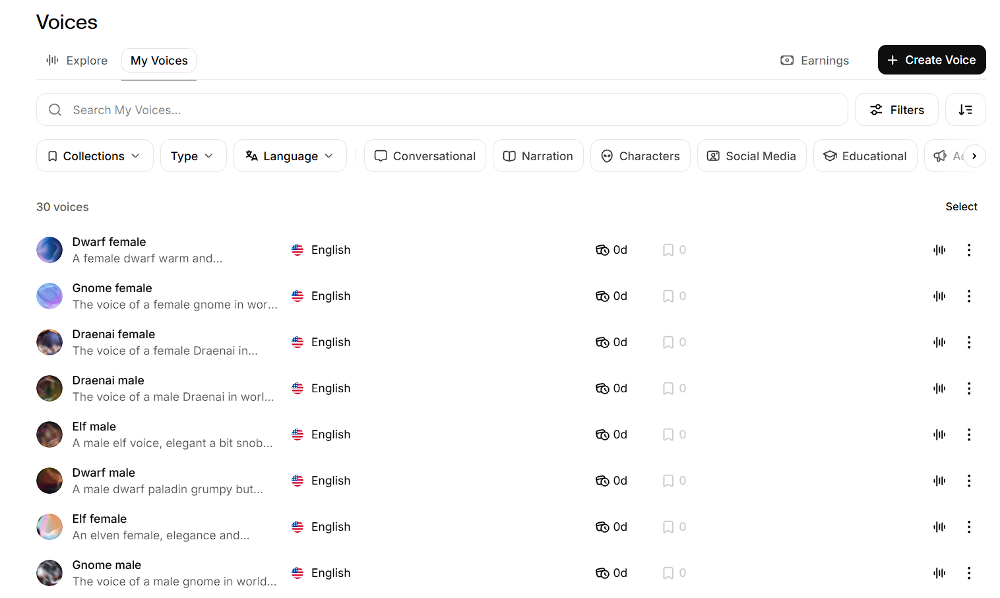
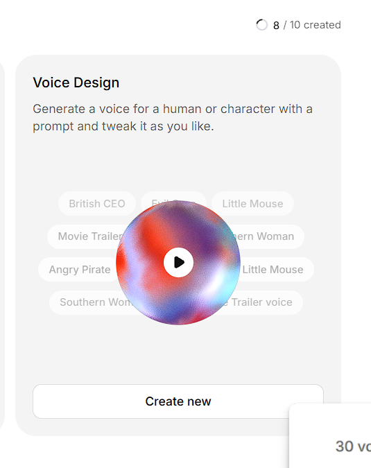
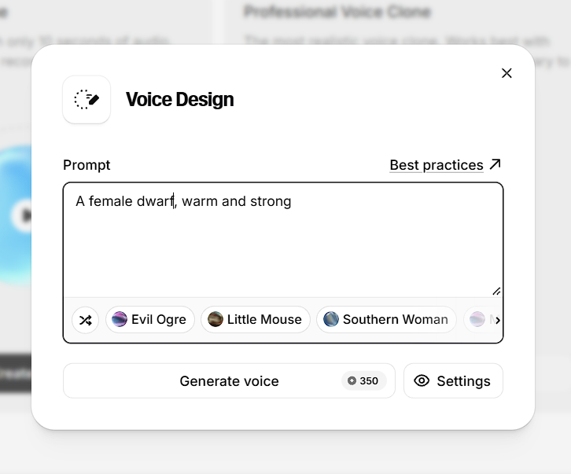
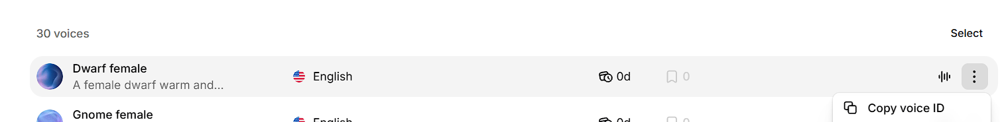

# Voices Quick Start (PoC Branch)

Hear your bots and nearby NPCs speak their chat lines aloud, each with a
voice that fits their race and gender. This guide gets you from zero to
voiced chatter on the `feature/tts-voice-poc` branch.

> **Experimental.** Voice is a proof of concept, off by default, and only
> available on this branch. Text chat never waits for it and is never
> changed by it.

What you will hear: say, yell, NPC say and party lines that you actually
receive in game. Volume fades with distance (up to `SayRadius` yards), and
each voice is placed left or right of you. General, guild, raid and
battleground chat stay silent.

---

## 1. What you need

- A working mod-llm-chatter setup (bridge running, bots chatting).
- **Windows**, on the same PC as your WoW client. The voice helper runs
  there, not in Docker.
- **Python 3.10+** on Windows.
- MySQL reachable from Windows (Docker setups expose it on `127.0.0.1`).
- An **ElevenLabs account** (see step 3).

## 2. Switch to the branch and update the server

From the module folder:

```bash
cd modules/mod-llm-chatter
git fetch origin
git switch feature/tts-voice-poc
```

Then:

1. **Run the database migration** (characters database):

   ```bash
   docker exec -i ac-database mysql -uroot -ppassword acore_characters < \
     modules/mod-llm-chatter/data/sql/characters/updates/20261029_voice_mailbox.sql
   ```

2. **Rebuild and restart the worldserver.** The server side of the
   feature is C++.
3. **Restart the chatter bridge.**

## 3. ElevenLabs account and API key

1. Sign up at [elevenlabs.io](https://elevenlabs.io).
   - The **Free** plan has 10,000 credits a month and 3 custom voices.
   - The **Starter** plan has 30,000 credits a month and 10 custom voices.
     That is enough for one male and one female voice for 5 race groups.
     This PoC was tested on Starter.
2. Create an API key in your ElevenLabs account (the **API Keys** page).
   Give it at least these permissions:
   - **Text to Speech**
   - **Voices: Read** (to check your voice ids)
   - **User: Read** (to show your remaining credits)

Keep the key private. It only ever goes in your active config.

Plans and credit amounts can change; check
[the pricing page](https://elevenlabs.io/pricing).

## 4. Create voices for the WoW races

You can use any voice in your account, but custom voices designed from a
text prompt sound far more like Azeroth. Each saved voice uses one custom
voice slot.

**a. Open Voices → My Voices and click Create Voice.**



**b. Choose Voice Design → Create new.**



**c. Describe the voice and click Generate voice.**



ElevenLabs generates three previews. Pick the one you like and save it
under a clear name such as `Dwarf female`. Generating costs a few
hundred credits, shown on the button; saving is free.

Prompt tips (from ElevenLabs' Voice Design guide):

- Describe gender, age, tone, pacing and personality. More detail gives
  more accurate results.
- Adding "studio-quality recording" can improve clarity.
- Avoid effect words like "echo" or "reverb", and vague words like
  "exotic".

Prompt ideas, one per voice slot in the map:

| Slot | Example prompt |
|---|---|
| Human male / female | A steady, warm adult man / a confident adult woman, medieval fantasy soldier |
| Elven male / female | A calm, refined, slightly haughty elven man / a soft, elegant elven woman |
| Dwarf male / female | A gruff, hearty older dwarf / a sturdy, warm and strong dwarf woman |
| Gnome male / female | A quick, bright, slightly high-pitched gnome tinkerer / an energetic, playful gnome woman |
| Brute male / female | A deep, gravelly, forceful orc warrior / a strong, low, commanding orc woman |

**d. Copy each voice id.** In **My Voices**, open the **⋮** menu next to
a voice and choose **Copy voice ID**.



> Voices made with Voice Design can't be shared with other accounts, so
> every tester creates their own.

## 5. Fill your voice map

Copy `modules/mod-llm-chatter/tools/voice_map.json` somewhere outside the
module, for example next to your config, so module updates never
overwrite it. Paste your voice ids into the `voice_id` fields:

```json
"dwarf": {
  "races": [3],
  "male":   {"voice_id": "your-dwarf-male-id",   "hint": "..."},
  "female": {"voice_id": "your-dwarf-female-id", "hint": "..."}
}
```

- **`defaults.male` must be set**, or the helper won't start. Fill
  `defaults.female` too.
- Any empty slot falls back to the default voice for that gender.
- Race ids: 1 Human, 2 Orc, 3 Dwarf, 4 Night Elf, 5 Undead, 6 Tauren,
  7 Gnome, 8 Troll, 10 Blood Elf, 11 Draenei.
- To give a race its own voices, move its id out of a group into a new
  entry, for example `"draenei": {"races": [11], ...}`.
- To list the voices your account can use (free, no credits):
  `python modules/mod-llm-chatter/tools/tts_agent.py --config <your conf> --list-voices`

## 6. Configure

Copy the **Voice (TTS) Feature** section from
`conf/mod_llm_chatter.conf.dist` into your active
`env/dist/etc/modules/mod_llm_chatter.conf`, then set:

```ini
LLMChatter.Voice.Enable = 1
# The account id you play on
LLMChatter.Voice.BoundAccountId = 1
# Windows can't resolve Docker hostnames
LLMChatter.Voice.DBHost = 127.0.0.1
LLMChatter.Voice.ElevenLabs.ApiKey = your-key-here
# Absolute path to your copy from step 5
LLMChatter.Voice.VoiceMapFile = C:/path/to/voice_map.json
```

Apply it in game with `.reload config` as a GM.

Optional: `LLMChatter.Voice.Pan.Source = camera` places voices relative to
your camera instead of your character. It needs Windows and client build
3.3.5a (12340).

## 7. Start the helper

On Windows, once:

```
python -m pip install -r modules/mod-llm-chatter/tools/requirements.txt
python -m pip install -r modules/mod-llm-chatter/tools/requirements-voice.txt
```

Then, each time you play:

```
python modules/mod-llm-chatter/tools/tts_agent.py --config env/dist/etc/modules/mod_llm_chatter.conf
```

At startup it checks each voice id (`OK`, `EMPTY` or `UNSUPPORTED`) and
shows your remaining credits. Keep the window open while you play;
Ctrl+C stops the voices, and the server carries on normally.

## 8. Troubleshooting

| Symptom | What to check |
|---|---|
| Helper refuses to start | `Voice.Enable = 1`, `defaults.male` set, API key present |
| No voices at all | `BoundAccountId` is the account you play on; migration ran; worldserver rebuilt |
| A voice is the wrong one | The voice id shows `OK` at startup; empty or unknown ids fall back to the default |
| Some lines are skipped | Normal when many bots talk at once: a line that would start more than `MaxLagSeconds` late is dropped. Raise it (up to 30) to hear more of them late |
| Voices stopped mid-session | Out of credits, or the audio device changed; the helper logs the reason |
| Video recordings miss the voices | Xbox Game Bar: untick *Mute system and app audio when recording a game* |

## Going back

Set `LLMChatter.Voice.Enable = 0` (or just don't start the helper), then
switch back with `git switch master` and rebuild. The voice table is
harmless if left in place.

For every voice setting, see the **Voice (PoC)** section of the
[README](../README.md#voice-poc).
